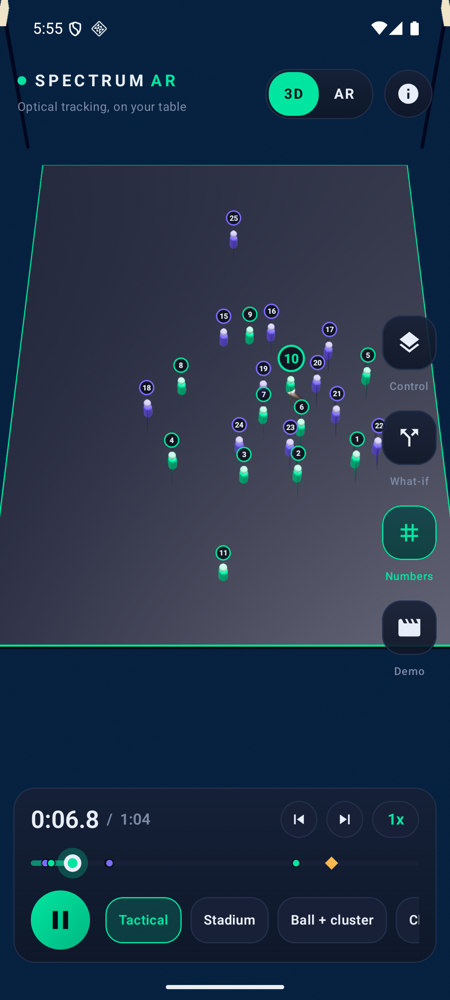
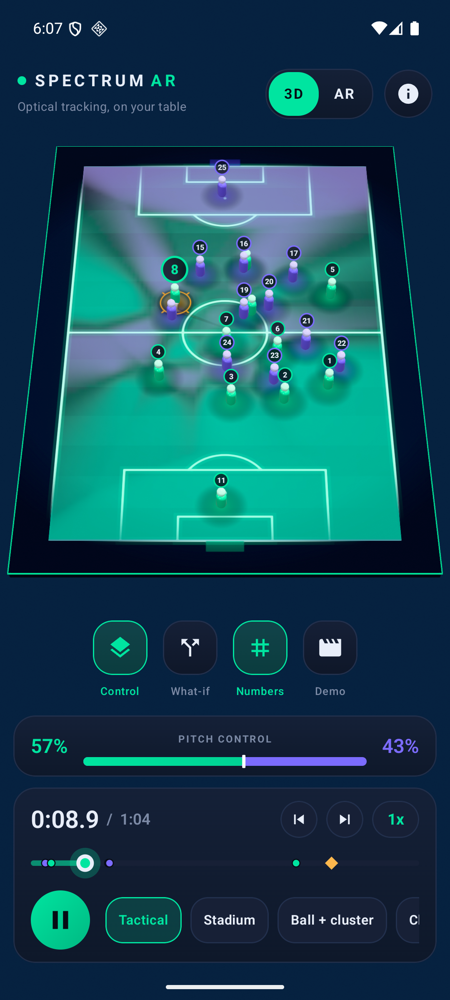
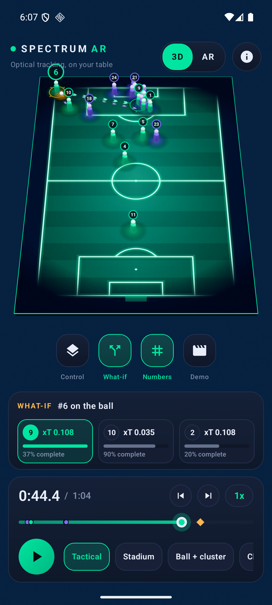
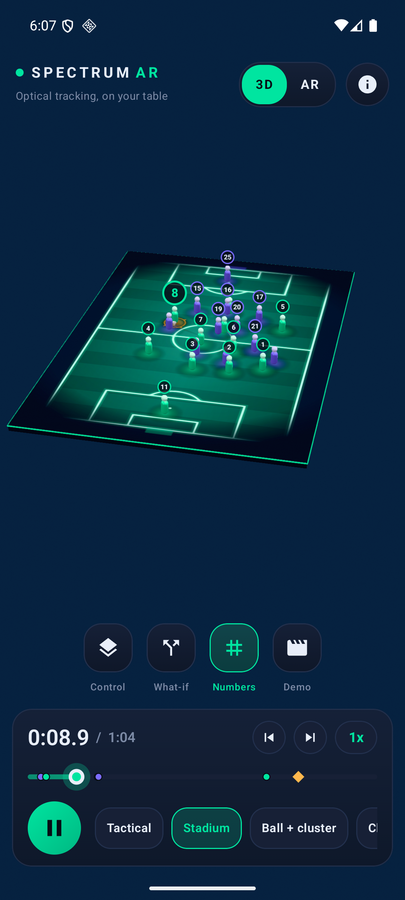
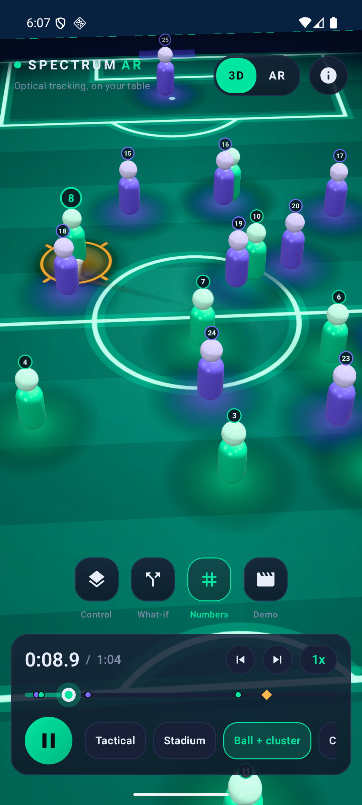
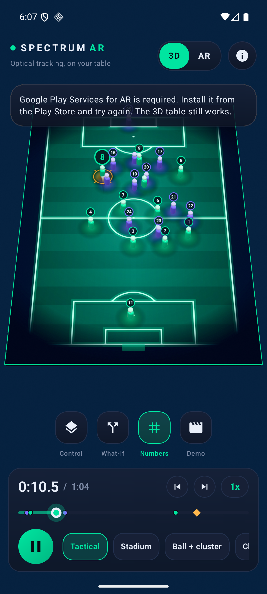

# Spectrum AR for Android

A tactical board built from real optical tracking data: 22 players and the ball replayed as a 3D table you can orbit, scrub and place on a real surface in AR. Native Kotlin, Jetpack Compose (Material 3) and SceneView (Filament + ARCore).

Independent portfolio concept. Not an official product.

## Screenshots

Captured on an Android 16 arm64 emulator (3D table mode). AR cannot run there, see "Testing status".

| Table 3D | Pitch control | What-if |
| --- | --- | --- |
|  |  |  |

| Stadium camera | Ball + cluster | AR unavailable |
| --- | --- | --- |
|  |  |  |

## Features

- Replay of Metrica Sample_Game_1 tracking (25 Hz, bundled and decimated in `app/src/main/assets`) with play/pause, 4 speeds, a scrubber with key moments (goal, shots, set pieces) and previous/next moment buttons.
- 3D table: players, ball, ball trail, 5 second trail of the selected player, tap a player for speed, distance and top speed.
- Pitch control overlay: for every point of the pitch, which team arrives first (arrival-time model computed on the phone, refreshed about 12 times per second), with a live home/away share bar.
- What-if mode: pauses on the ball carrier and ranks pass options by expected threat (Karun Singh xT grid) times pass success probability, drawn as animated arrows. Drag any player and the ranking recomputes.
- Readable jersey numbers: a label layout pass separates overlapping numbers, fades far ones and always keeps the ball carrier and selected player on top.
- Camera rig: Tactical, Stadium, Ball + cluster, Close-up and Free presets. One finger orbits, two fingers pan and pinch zoom. The framing keeps the whole board on screen and lifts it above any open panel.
- Demo mode: a hands-free, captioned 60 second tour of all of the above, for screen recording. Tap anywhere to exit.
- AR mode: scan a horizontal surface, tap to place the table (about 60 cm wide), pinch to scale, twist to rotate, tap players. The same replay and tools work.
- Haptics on key actions, dark theme using the shared design tokens, splash screen and About sheet with data credits.

## Requirements

- AR mode: an ARCore supported phone (see https://developers.google.com/ar/devices), Google Play Services for AR installed, camera permission.
- 3D table mode runs on any Android 8.0 (API 26) or newer device with OpenGL ES 3.0. If ARCore is unsupported, missing, or the camera permission is denied, the app shows a clear message and stays in table mode.
- The APK contains arm64-v8a native libraries only (all current phones).

## Install the prebuilt APK

    adb install -r dist/spectrum-ar-debug.apk

## Build and test

Requires Android SDK (platform 37) and JDK 21 (SceneView is compiled for Java 21).

    export ANDROID_HOME=$HOME/Library/Android/sdk
    export JAVA_HOME=<path to a JDK 21>
    ./gradlew testDebugUnitTest assembleDebug
    ./gradlew installDebug

## Project layout

- `core/` pure logic with unit tests: tracking decoding, replay clock, timeline markers, pitch control, xT and pass evaluation, label layout, camera rig and framing math.
- `scene/` Filament scene (pitch, players, ribbons, overlays, projector).
- `ar/` ARCore session, placement and availability handling.
- `ui/` Compose HUD, theme, gestures, app shell, About sheet.
- `app/` the controller shared by both modes, and the demo script.

## Testing status

Verified on the Android emulator (arm64, Android 16), by driving every screen with adb input and reading screenshots and logcat:

- 81 JVM unit tests pass (`./gradlew testDebugUnitTest`).
- Splash, table scene, replay, scrubber, key-moment buttons, speed, camera presets, tap selection with stats card, orbit/pan gestures, pitch control overlay, what-if panel with player drag, numbers toggle, demo mode, About sheet.
- AR button on the emulator: camera permission denial and the ARCore-not-installed case both end in a message and a working table mode, with no crash.

NOT verified: the AR session itself (plane detection, tap to place, scale and rotate gestures, anchor loss handling). ARCore does not run in the emulator, so this code path has only been compiled and reviewed, never run against a real camera. Treat AR as untested until it has been tried on a physical phone. Frame rate on a real device has also not been measured, and the instrumented/Compose UI tests are not included.

## Data credits

- Tracking data: Metrica Sports open sample data, Sample_Game_1 (https://github.com/metrica-sports/sample-data).
- Expected threat grid: Karun Singh, open xT model (https://karun.in/blog/expected-threat.html).

Pitch control, pass ranking and the demo are local models on open data, not a live feed.
